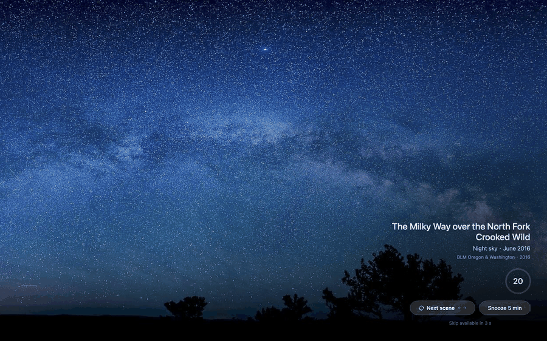
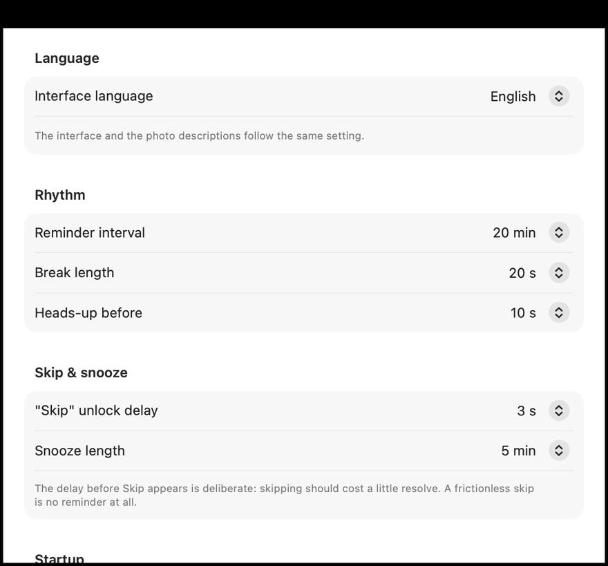
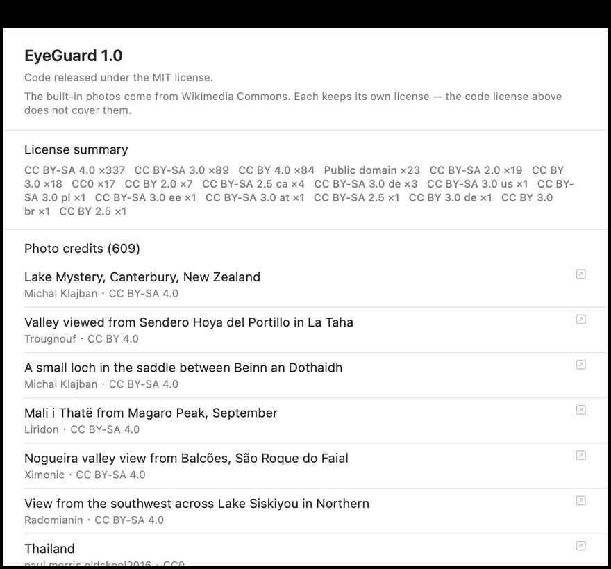
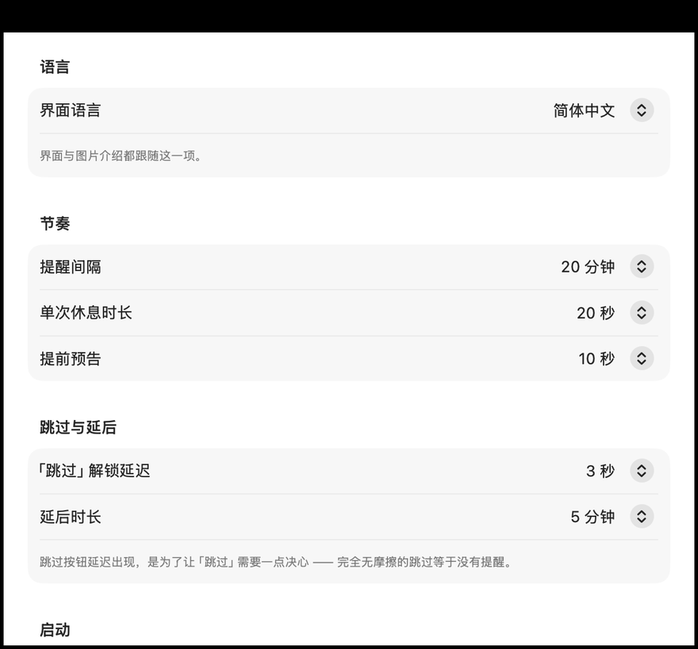

# EyeGuard

**A macOS menu-bar app that takes over your screen every 20 minutes and shows you a
landscape photograph — 609 of them, hand-screened, each with a caption that traces
back to its source metadata.**



Not another countdown timer. The break screen itself has something to look at.

<sub>中文说明见下方 · [跳到中文](#eyeguard-中文说明)</sub>

---

## Install

```bash
cd ~/Downloads
curl -L -o eyeguard.zip \
  https://github.com/janson202508/eyeguard/releases/latest/download/EyeGuard-1.0-macos.zip
unzip -q eyeguard.zip && mv EyeGuard.app EyeGuardLauncher.app /Applications/
```

Then open **EyeGuard 控制台** from Launchpad and press 启动护眼. A menu-bar icon
appears; 20 minutes later it takes over the screen for 20 seconds.

**Requires macOS 13+.** About 250 MB — the photographs are bundled.

> ### ⚠️ Install from the terminal, not a browser
>
> This app is **not code-signed or notarized** (that requires an Apple Developer
> account, $99/year — this is a free project with no revenue).
>
> Browsers tag downloads with `com.apple.quarantine`. macOS blocks quarantined
> unsigned apps on first launch, and **since macOS 15 the old "right-click → Open"
> bypass is gone** — users must go through System Settings → Privacy & Security →
> Open Anyway → password. `curl` does not set that attribute, so the terminal path
> installs and launches cleanly. Both halves of that were measured, not assumed.
>
> Already downloaded via a browser? Either:
> ```bash
> xattr -dr com.apple.quarantine /Applications/EyeGuard.app
> xattr -dr com.apple.quarantine /Applications/EyeGuardLauncher.app
> ```
> or use System Settings → Privacy & Security → **Open Anyway**.

## Why this one

Break-reminder apps are not scarce. Most are a countdown overlay, and the
"background" is a solid colour or whatever image you supply yourself.

EyeGuard's difference is **the content**, and the discipline behind it:

- **609 photographs, individually screened.** Not "supports custom backgrounds" —
  a curated library, filtered for licence, composition, absence of man-made objects,
  and near-duplicate frames, then sorted into 10 scene categories so two consecutive
  breaks never look alike.
- **Every caption is traceable.** Each photo carries a bilingual caption plus a
  `captionSource` field recording which metadata it came from
  (`ImageDescription`, GPS reverse-geocoding, or a hand-checked category label).
  **Nothing is invented** — place names are never guessed or machine-translated;
  if a name can't be verified it stays in the original language.
- **Native Swift / SwiftUI**, ~13k lines, no Electron.
- **No network at runtime, no telemetry.** Break screens read local files only.
- **Bilingual** (English / 简体中文), switchable in Settings.

| | |
|---|---|
| 20-20-20 timer | 15 / 20 / 30 / 45 min intervals |
| Full-screen takeover | skippable after 3 s (deliberate friction) |
| Defers automatically | idle ≥ 5 min, another app full-screen, camera in use, screen locked or asleep |
| Change scene | `←` / `→` or the button — restarts that break's countdown |
| Night dimming | dims and filters warm tones during chosen hours |
| Scene control | enable by category (built-in) or per image (imported) |
| Import your own | drag in a folder; content-hash deduplication, auto downscaling |



## The part worth reading if you like process

The code is ordinary. **The documentation is not**, and it's the reason this repo
exists in public rather than on a hard drive.

Two documents, both in Chinese:

- **[测试指南.md](测试指南.md)** — a test guide with eight layers, from a 30-second
  smoke test to a week-long rhythm calibration. Its unusual part is a rule: **every
  automated check must be shown capable of failing.** A check that can never fail is
  not a check. The guide records, for each assertion, the deliberately-broken input
  that made it go red — and several of those reverse controls caught assertions that
  were wrong (a "credit line fits on one line" check that only looked for `http` and
  missed `www.`; a "no repetition" check that compared raw substrings and tripped on
  a place name containing its own category word).
- **[需求规格书-v1.md](需求规格书-v1.md)** — the specification. Requirements and
  acceptance criteria, plus **the reasoning behind each decision — including
  decisions that were later reversed**, kept in the record rather than deleted.

A few things measured rather than assumed, all documented in those files:

- **Choosing the JPEG quality.** Packaging was 415 MB. We measured nine
  (resolution, quality) combinations on a 40-photo sample. The counter-intuitive
  result: **dropping resolution costs far more than dropping quality** — 1600 px at
  q80 saves only 7 percentage points more than 1920 px at q72, while losing 2.6 dB.
  Also, on a 2880-px-wide Retina screen the 1920 px assets are *already* being
  upscaled 1.5×. So: keep the long edge, drop quality to 72. **415 MB → 249 MB.**
  The quality cost is quantified (difference RMS 1.5–3.9/255) and the difference was
  amplified 8× to confirm artifacts land only in smooth gradients.
- **Verifying layout from pixels only.** The UI reports its own control coordinates —
  which proves nothing, since the coordinate origin and y-axis direction are
  conventions. So the checks read the *rendered PNG* and look for bright pixels,
  asserting the bounding box sits in the lower-right quadrant.
- **Discovering the app could not legally be distributed.** The asset library
  contained 17 macOS wallpapers. Their own `license` field said *"for local use only,
  may not be redistributed with the app"* — which made the entire app
  non-distributable. Removed. All 609 remaining photos are CC BY / CC BY-SA / CC0 /
  public domain, and CC's attribution requirement (credit + licence + link) is
  satisfied in-app at **Settings → About**, generated at runtime from the library.

## Scenes

The photographs are **generated, not committed** (410 MB of JPEGs). The repository
keeps only the human judgements that cannot be recomputed:

| File | What it is |
|---|---|
| `EyeGuard/Assets/keep.json` | which candidates were kept, with `depthScore` / `tone` — hand-labelled from looking at the images |
| `EyeGuard/Assets/candidates-index.json` | candidate metadata (title → URLs, author, licence), so `finalize` can re-run offline |
| `EyeGuard/Assets/Scenes/caption-source.json` | the auditable source data behind every caption |
| `EyeGuard/Assets/Scenes/manifest.json` | the built scene library metadata |

To rebuild a library from Wikimedia Commons:

```bash
cd EyeGuard
python3 Tools/fetch_scenes.py --out /tmp/eg search   # keyword + category search
python3 Tools/fetch_scenes.py --out /tmp/eg sheet    # contact sheets for review
#   → look at the sheets, write keep.json
python3 Tools/fetch_scenes.py --out /tmp/eg finalize --keep keep.json --max-edge 1920
python3 Tools/i18n/build_captions.py --apply         # regenerate captions
```

`fetch_scenes.py` also has a `pools` subcommand that walks Wikimedia's
human-reviewed quality/featured pools. Both paths share the same filtering code —
the pool route guarantees good photography but *not* the absence of man-made
objects, which is why `ocean` is mostly built from keyword search instead.

## Assets and licensing

**Code: MIT** (see [LICENSE](LICENSE)).

**Photographs are not covered by the code licence.** All 609 come from Wikimedia
Commons under CC BY / CC BY-SA / CC0 / public domain, attributed individually —
author, licence, and a link to the source page — in **Settings → About**.



> **Every asset must be redistributable, or the app cannot ship at all.** That is a
> 0/1 gate, not a quality metric. The check is one command, and it runs before any
> release:
> ```bash
> python3 -c "import json;d=json.load(open('manifest.json'));\
> print([a['fileName'] for a in d if not a['license'].startswith(('CC','Public'))])"
> # must print []
> ```

## Development

```
EyeGuard/            menu-bar app (LSUIElement, no Dock icon)
EyeGuardLauncher/    single-window control panel (has a Dock icon)
install.sh           builds both, installs to /Applications
make-release.sh      builds + packs a GitHub Release zip
```

Two independent processes, talking over `DistributedNotificationCenter`
(prefix `info.xiaolu.eyeguard.`). **The protocol exists as a copy on each side —
change one, change the other.**

```bash
cd EyeGuard
bash build.sh release
./build/EyeGuard.app/Contents/MacOS/EyeGuard --self-test    # ~2 min
```

Other entry points: `--preview`, `--test-mode`, `--shot-rest <dir> [WxH]`,
`--shot-settings <dir>`, `--probe-keys`, `--probe-overlay`. Full list in the test guide.

Python tools need `pillow`.

## Status

Working, self-tested, used daily. **Not yet packaged for strangers**: no code
signing or notarisation, no auto-update. Those are the next things.

## License

Code: **MIT**. Bundled photographs keep their own Wikimedia Commons licences —
see **Settings → About** in the app.

---

# EyeGuard 中文说明

常驻 macOS 菜单栏的 20-20-20 护眼提醒。每 20 分钟接管整屏，给你看一张风景照 ——
**609 张，逐张人工筛过，每张都带一条可回溯的双语介绍**。

它不是又一个倒计时。休息画面本身有内容。


## 安装

```bash
cd ~/Downloads
curl -L -o eyeguard.zip \
  https://github.com/janson202508/eyeguard/releases/latest/download/EyeGuard-1.0-macos.zip
unzip -q eyeguard.zip && mv EyeGuard.app EyeGuardLauncher.app /Applications/
```

然后从「启动台」打开 **EyeGuard 控制台**，点「启动护眼」。菜单栏会出现一个眼睛图标，
20 分钟后接管整屏 20 秒。

**需要 macOS 13+。** 约 250 MB —— 风景照打包在里面。

> ### ⚠️ 请用终端安装，不要用浏览器下载
>
> 这个 App **没有代码签名与公证**（那需要 Apple Developer 账号，$99/年；
> 本项目免费、没有收入）。
>
> 浏览器会给下载的文件打上 `com.apple.quarantine` 隔离属性，macOS 会拦住首次启动；
> 而 **macOS 15 起「右键 → 打开」的绕过方式已被 Apple 移除**，用户必须走
> 「系统设置 → 隐私与安全性 → 仍要打开 → 输密码」。`curl` 不会打这个属性，
> 所以终端路径装完就能直接跑。这两件事都是实测的，不是推断。
>
> 已经用浏览器下载了？任选一种：
> ```bash
> xattr -dr com.apple.quarantine /Applications/EyeGuard.app
> xattr -dr com.apple.quarantine /Applications/EyeGuardLauncher.app
> ```
> 或者走 系统设置 → 隐私与安全性 → **仍要打开**。

## 和别的比，不同在哪

休息提醒类工具不缺。绝大多数是一个倒计时浮层，「背景」要么是纯色，要么让你自己找图。

EyeGuard 的差别在**内容**，以及内容背后的规矩：

- **609 张照片，逐张筛过。** 不是「支持自定义背景」，是一个筛选过的素材库：
  按授权、构图、有无人造物、有无近重复帧逐张过，再分成 10 个场景类别，
  保证相邻两次休息看到的画面不雷同。
- **每条介绍都能回溯。** 每张图带一条双语介绍，外加一个 `captionSource` 字段
  记录它的依据（`ImageDescription` / GPS 反地理编码 / 人工核对的类别名）。
  **不编造** —— 地名从不臆测翻译，查不到就保留原文。
- **原生 Swift / SwiftUI**，约 1.3 万行，不是 Electron。
- **运行时不联网、零遥测。** 休息画面只读本地文件。
- **中英双语**，设置里可切。



## 如果你喜欢「过程」，这部分值得看

代码本身很普通。**不普通的是文档** —— 这也是这个仓库公开存在、而不是躺在硬盘上的原因。

两份中文文档：

- **[测试指南.md](测试指南.md)** —— 八层测试指南，从 30 秒冒烟到跑一周校准节奏。
  它特别的地方是一条规则：**每个自动检查都必须被证明「能失败」。**
  一个永远通过的检查等于没有检查。指南里逐条记录了「用什么故意做坏的输入让它变红」——
  而其中几条反向对照**当场抓出了写错的断言**（「署名放得进一行」只查了 `http` 漏了 `www.`；
  「不得重复」用字符串包含判断，栽在 `羚羊峡谷` 含 `峡谷` 上）。
- **[需求规格书-v1.md](需求规格书-v1.md)** —— 规格书。需求与验收标准，
  外加**每个决定背后的理由 —— 包括后来被推翻的决定**，留在记录里而不是删掉。

几件「量出来的、不是拍脑袋」的事，都写在那两份文件里：

- **怎么定的 JPEG 质量。** 打包原本 415 MB。我们抽 40 张量了九种（分辨率, 质量）组合。
  反直觉的结论是：**降分辨率的代价远大于降质量** —— 1600px q80 只比 1920px q72
  多省 7 个百分点，PSNR 却掉 2.6 dB。而且 Retina 屏（物理 2880px 宽）本来就在把
  1920px 放大 1.5 倍用。于是**保持长边、质量降到 72**，**415 MB → 249 MB**。
  质量代价被量化（差值 RMS 1.5–3.9/255），并把差值**放大 8 倍**成图确认伪影只落在
  平滑渐变上。
- **布局只信渲染出来的像素。** UI 会自报控件坐标 —— 那证明不了任何事，因为坐标系原点
  和 y 轴方向都是约定。所以检查改成读**渲染出的 PNG**、找高亮像素、断言包围盒落在右下象限。
- **发现这个 App 曾经不允许被分发。** 素材库里有 17 张 macOS 随附壁纸，
  它们的 `license` 字段自己写着「仅限本机自用，不可随 App 分发」——
  也就是说那 17 张让**整个 App 不能发布**。已移除。剩下 609 张全部是
  CC BY / CC BY-SA / CC0 / 公有领域，而 CC 要求的**署名 + 许可声明 + 链接**三件套
  在应用内「设置 → 关于」页由素材库运行时生成。

## 素材

风景照是**生成物，不进仓库**（410 MB）。版本库只保留**人工判断的产物**：

| 文件 | 是什么 |
|---|---|
| `EyeGuard/Assets/keep.json` | 留下了哪些候选，含 `depthScore` / `tone` —— 看图手标的 |
| `EyeGuard/Assets/candidates-index.json` | 候选元数据（标题 → URL / 作者 / 许可），`finalize` 可离线重跑 |
| `EyeGuard/Assets/Scenes/caption-source.json` | 每条介绍背后的可审计来源数据 |
| `EyeGuard/Assets/Scenes/manifest.json` | 构建出的素材库元数据 |

从 Wikimedia Commons 重建素材库的流程见上方 [Scenes](#scenes) 一节。

## 素材与授权

**代码：MIT**（见 [LICENSE](LICENSE)）。

**照片不受代码许可覆盖。** 609 张全部来自 Wikimedia Commons，以 CC BY / CC BY-SA /
CC0 / 公有领域发布，在**设置 → 关于**页逐条署名 —— 作者、许可、原图页链接。

> **任何一张素材不能随 App 分发，整个 App 就不能发布。** 这是 0/1 的闸门，
> 不是质量指标。发布前必跑的一条命令：
> ```bash
> python3 -c "import json;d=json.load(open('manifest.json'));\
> print([a['fileName'] for a in d if not a['license'].startswith(('CC','Public'))])"
> # 必须输出 []
> ```

## 开发

```
EyeGuard/            菜单栏本体（LSUIElement，无 Dock 图标）
EyeGuardLauncher/    「EyeGuard 控制台」单窗口面板（有 Dock 图标）
install.sh           构建两个程序并装到 /Applications
make-release.sh      构建 + 打成 GitHub Release 用的 zip
```

两个**独立进程**，用 `DistributedNotificationCenter`（前缀 `info.xiaolu.eyeguard.`）通信。
**协议两侧各有一份副本 —— 改一边必须改另一边。**

```bash
cd EyeGuard
bash build.sh release
./build/EyeGuard.app/Contents/MacOS/EyeGuard --self-test    # 约 2 分钟
```

其余入口：`--preview`、`--test-mode`、`--shot-rest <目录> [WxH]`、`--shot-settings <目录>`、
`--probe-keys`、`--probe-overlay`。完整清单见测试指南。

Python 工具需要 `pillow`。

## 状态

能跑、自检全过、每天在用。但**还不是能给陌生人用的东西**：没有签名与公证、没有自动更新。
这些是接下来的事。

## 许可

代码以 **MIT** 发布。内置照片各自适用其 Wikimedia Commons 原始许可 —— 见应用内「设置 → 关于」。
